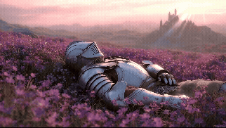

<!-- HEADER -->

  

 

<!-- BANNER -->

  

 

 

<!-- ABOUT -->

  

    Estudante de Inteligência Artificial na Unimar ⚔️ 
  

 

<!-- STACK + CAVALEIRO -->

<table>
<tr>

<td valign="top" width="55%">

<h2>✦ Tecnologias ✦</h2>

</td>

<td align="center" width="45%">

 

</td>

</tr>
</table>

 
